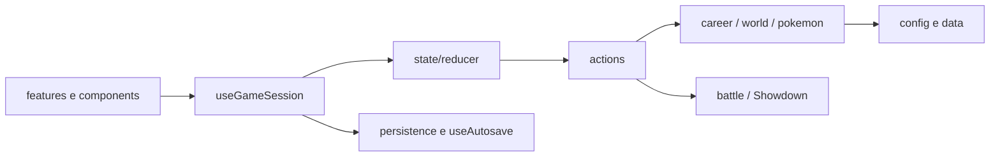

# Arquitetura do Pokébobo

## Além da trilha — 0.24.0

`config/expeditions` define desbloqueio, posições, orçamento e prêmios; `data/expeditions` guarda texto e mapas. O domínio puro `expeditions/` controla movimento, colisão, coleta e tesouro. `actions/expedition` valida entrada/fase/proximidade, cobra uma semana só na entrada direta e resolve `afterWeek` apenas na saída, sem empilhar evento/emboscada. Entrada pelo campo aproveita o gasto anterior e encerra a caminhada.

`run.expeditions` registra cada visita; `activeExpedition` identifica a sala ativa. Fase expedition inclui exploração e escolha de tesouro após vitória. Baús e bolsa são transações únicas; RESULT marca won sem conceder prêmio, EXPEDITION_REWARD concede item/dinheiro e marca cleared. Saída marca escaped quando não houve guardião. `beginBattle/result` usam kind expedition, preservam feitos, itens e baixas reais e não dão níveis. `finishRun` arquiva visitas; `checkExpeditions` valida backups. Campos aditivos no schema 4.

`features/expeditions` separa acesso, confirmações, cena, controles e tesouro. Reutiliza PixelViewport, useFieldControls, usePixelCanvas, Modal, Sprite e áudio local. Cenografia própria em canvas; Red já local. Equipe/reserva/equipamentos podem mudar na fase de sala, nunca no combate. [Guia](EXPEDICOES.md).


## Companheiros de jornada — 0.23.0

Três domínios independentes: `rival/` monta linhagens/elencos e guarda lembranças de duelos; `equipment/` administra cópias, equipamento e preparo; `heroes/` lê o protocolo completo e agrega feitos. Configurações ficam em `config/`, perfis narrativos em `data/rivals`. Novos comandos permanecem em arquivos próprios em `actions/`.

O rival é criado ao selecionar o inicial, com perfil determinístico que pode ser escolhido no estado ready. Três janelas opcionais têm nível/prêmio fixos; `beginBattle` e `result` usam kind rival e conservam a fase de retorno ao Mercado/carreira. Não alteram a política da IA. O prêmio e o registro de vitória são aplicados uma vez no RESULT, sem semanas/níveis extras.

Equipamentos usam `mon.item`, com estoque solto em `run.heldItems` e ofertas limitadas em `marketPurchases`. Compra valida alvo/saldo/estoque antes de debitar/equipar. `returnEquipment` trata venda/liberação; a reserva conserva equipamentos e descarta berries preparadas. Preparo normal/de evento só ocupa vagas vazias. Resultado do motor continua autoritativo para consumo/remoção/troca em batalha.

`battleFeats` não depende de UI: lê o log inteiro, elimina linhas públicas duplicadas e atribui somente nocautes diretos. `snapshot` inclui o resumo quando encerrado; `result` agrega em `heroRecords` antes de remover baixas do Nuzlocke. `finishRun` guarda destaque, memorial e rival no Hall. IDs internos continuam sendo as chaves de batalha; apelidos são metadados visuais, sem alteração de set/RNG. Dados são aditivos no schema 4; nenhum histórico recebe feitos inventados.

`features/rival`, `equipment` e `heroes` concentram componentes por arquivo. Hall/encerramento e gerador PNG reutilizam o destaque, ficha/bolsa compartilham a janela de equipamento. `qa-journey.mjs` verifica fluxos de UI com Playwright externo; `audit-companions.mjs` mede economia/confrontos reais. [Guia e limites](COMPANHEIROS-DE-JORNADA.md).

## Rare Candy — 0.22.1

`MARKET_RARE_CANDY` em `config/market` define preço/ganho. `actions/market-candy` valida fase, dinheiro e alvo abaixo do teto antes de usar `growWithLearning` somente naquele indivíduo e debitar o valor. O reducer existente bloqueia compras enquanto houver escolhas pendentes. `actionMoments` observa essa nova ação após a gravação para apresentar evolução. `RareCandyOffer`/`RareCandyDialog` reutilizam os estilos e o Modal do mercado; não criam inventário ou estado persistido de compra. `market:candy-audit` mede o preço relativo e combates reais pareados.

## Mercado da Liga — 0.22.0

`actions/result` sorteia os mesmos adversários após a oitava insígnia e abre a fase `market`. `actions/market` aplica venda, compra/ensino e saída; `market/market` concentra avaliação, compatibilidade e disponibilidade. Os parâmetros/ofertas estão em `config/market`. A seleção do alvo/golpe pertence à UI até a transação única, sem estado de compra pendente. `money`, `marketPurchases` e `mon.tmMoves` são dados aditivos; crescimento automático preserva TMs ainda equipadas. Box, líder e evolução podem ser gerenciados durante a parada.

`scripts/market-catalog.mjs` compila fontes de máquina da linhagem para `data/marketCompatibility.json`; `check` verifica a correspondência sem regravar o arquivo. Learnsets completos continuam fora do browser. `features/market` usa Modal, Sprite, TypeTag, RouteCover e MoveSummary existentes; CSS entra após career na cascata. `market:audit` mede economia e combates reais pareados. O simulador base usa MARKET_LEAVE sem negociar. [Regras e limites](MERCADO-DA-LIGA.md).

## Área visível e gestos — 0.20.1

`useVisualViewport` pertence à apresentação e escreve apenas altura/deslocamento visíveis em CSS. Atualizações são agrupadas por requestAnimationFrame, eventos/variáveis limpos ao desmontar; zoom mantém viewport nativo. Carcaça e dialog combinam essas medidas com tokens de áreas seguras. Sem essa API, CSS usa dvh. Nenhum dado entra em save ou no motor.

`Modal` exige gesto completo no fundo para fechar por ponteiro; padding interno/arrasto não encerram a janela. Escape e botão Fechar mantêm o contrato nativo, retorno de foco usa preventScroll. Rodapé de evoluções e layout de toque ficam na UI/CSS, mantendo os mesmos comandos. Cache lê arquivos estáticos locais com ignoreVary para suportar diferenças de Origin em servidores; a whitelist e os limites continuam restritos, sem API/save. [Guia mobile](MOBILE.md).

## Campo, condições públicas e acesso sem conexão — 0.20.0

`game/data/fieldLayouts.js` guarda quatro matrizes de terreno; `world/fieldLayout.js` escolhe por hash de seed/rota sem consumir RNG. `exploration.layoutId` é opcional, preservando campos já abertos sem redesenhar a posição. `terrainAt/isTallGrass/lakeDirection` alimentam tanto colisão quanto desenho/quadrantes e ações do lago. Preparação de pesca/Surf pertence à apresentação e conclui no comando existente. `drawField` inclui faixa superior de 16 px; grade física permanece 12×8, canvas 192×144. Sprite da vara carrega somente ao pescar.

`publicConditions` copia apenas identificadores públicos e camadas de hazards para o snapshot. `FieldConditions` traduz usando dados separados; nada de duração interna, fontes do motor, item ou habilidade escondida. `MoveSummary` usa `moveGuide` no aprendizado, conservando regras de escolha/PP do jogo.

`offlinePlugin.mjs` gera service worker apenas no build. Identidade depende do conteúdo do shell/template/assets essenciais. O worker guarda arquivos, nunca saves ou informações pessoais; shell versionado, uma versão anterior conservada, mídia compartilhada limitada (200 arquivos/60 MiB/4 MiB por arquivo). `put` é inteiro; leituras offline não regravam uma entrada em uso. Música atende Range sobre bytes completos. Nova versão espera todas as páginas anteriores fecharem, com aviso em Opções. `offlineClient` trata ciclo/conexão/prompt; não há atualização forçada em gameplay. Manifesto e ícones ficam em public; desenvolvimento não registra worker. [Guia e limites](CAMPO-E-OFFLINE.md).

## Batalha, backups e bundle — 0.19.0

`presentationEvents` enriquece o protocolo com golpe, alvo, resultado visual e causas públicas; não calcula dano. `battleSnapshot` interpreta o log uma vez e copia tipos/boosts. `useBattlePresentation` controla uma única sequência cancelável, concluída por fim, Pular, navegação ou pagehide/visibility. `useAutosave.persistNow` grava ações válidas antes de depender de uma renderização posterior. Não reexecutar histórico ao carregar.

`BattleEffects` desenha canvas transparente de até 480 px lógicos, mede corpos/apoio do sprite carregado e limpa os retângulos de HP. `visuals/` reúne perfis puros, geometria, desenhos e índice/preload local dos 18 atlas. `useBattleMotion` anima sprites no mesmo tempo do evento; cancela movimentos anteriores e respeita movimento reduzido. `BattleNotebook` consulta dados Gen 8/estado público via `moveGuide`; não revela sets secretos nem prevê dano. Áudio continua separado em `features/audio`; `battleTimbres` contém receitas próprias.

`game/persistence/importSave` valida JSON, versão atual, estrutura básica e replay de batalha, sem DOM. Restauração guarda chaves afetadas e tenta revertê-las se a escrita falhar. `ImportSaveDialog` apresenta arquivo/destino e exportação; só muda a sessão após sucesso. `shared/browserStorage` adia o acesso ao getter, permitindo tratamento de navegadores que negam a própria leitura. Detalhes em [BATALHAS-E-BACKUPS](BATALHAS-E-BACKUPS.md).

Somente no build, `browserSimulatorPlugin` substitui learnsets/legality do simulador por tabelas vazias: a aplicação usa catálogo pré-compilado e não TeamValidator. Dados/scripts de combate permanecem. `checkCompiledLearnsets` barra consultas removidas em src; `test:browser-simulator` empacota o mesmo motor e repete os testes, exceto os cinco do gerador Node que precisam das tabelas completas. O teste normal conserva esses cinco. Não remover tabelas de movimentos/regras/espécies ou mudar o Node para reduzir bundle.

## Presença na arena — 0.18.1

`battleSpriteLayout` deriva escala diretamente da caixa medida, sem teto fixo CSS. Perfil 2D atua como piso de presença do 3D da mesma espécie/lado; normal/shiny compartilham o aspecto mais largo para estabilidade. `BattlePokemonSprite` mede somente width/height. Limites de corpo, proporção/apoio/frames e renderer das animações continuam os mesmos. [Critérios atuais](ESCALA-DOS-SPRITES.md); descrição da 0.16 abaixo é histórica.

## Áudio — 0.18.0

`features/audio/AudioProvider` cria/destrói o mixer no ciclo de vida da aplicação; expõe comandos por contexto, guarda preferências fora do save e deriva a trilha em `audioScene`. `AudioEngine` usa Web Audio + dois media elements, transições, mute, ducking, cache/token por cena e visibilidade. O contexto só nasce no gesto. `chipEffects` contém síntese própria; tracks/cryIndex contêm apenas índices locais. Motor/game não importa áudio/DOM nem muda RNG.

`useAnimationAudio` recebe os mesmos ticks desenhados por `usePixelCanvas.onFrame`; `audioCues` deriva o som de captureTimeline e dos eventos de batalha. Desmontagem cancela cues/cries atrasados; fanfare de sucesso tem escopo separado para sobreviver ao retorno ao campo. `useBattlePresentation` toca somente os eventos novos, sem reexecutar o replay salvo. AudioButton/AudioDialog/AudioOptions são os controles, com CSS na cascata existente. Origem, importação, budget, comportamento e limites em [AUDIO.md](AUDIO.md).

## Pokédex e jornadas compartilhadas — 0.17.0

`features/pokedex/dexModel.js` deriva um índice normal/shiny da coleção permanente, deduplica aliases, atribui regionais à região da forma e aplica filtros sem alterar o save. `DexProgress`, `DexDetails` e `DexVariants` compõem a janela; comparação depende dos dois registros reais. Sprite 2D local conserva formas, e loading lazy limita a lista.

`features/history/journeyCardModel.js` normaliza registros novos/antigos; `renderJourneyCard.js` compõe canvas e QR com fontes/sprites locais, em import dinâmico. O efeito renderiza num canvas provisório e só publica o arquivo se a janela ainda estiver aberta. `ShareJourneyDialog` oferece download, clipboard com seleção manual de fallback e Web Share imediatamente no gesto do botão, depois de o arquivo estar pronto. Cancelar não reporta sucesso. Dialog nativo trata ESC sem fechar também o Hall de trás.

`game/world/regionChallenge.js` valida exclusivamente cidades canônicas, posição/ordem, unicidade, modo e uint32. `shared/regionInvitation.js` codifica fragmento PB1 e valida links/seeds; não carrega equipe ou recursos. `useRegionInvitation` recebe hashchange/convite inicial e protege a run ativa; modos de convite valem somente para aquela aventura. NEW/STARTER montam a região validada, mantendo o sorteio shiny separado. BEGIN grava `challengeStartRng` antes de arrival; finishRun o copia. Migração schema 4 já preserva campos adicionais. `fixedSeedDraft` faz a seed manual consumir os mesmos sorteios de origem independentemente do número de runs, enquanto novas aventuras comuns conservam o começo existente.

## Escala dos sprites — 0.16.0

Escala/apoio em `components/pokemon/battleSpriteLayout.js`, geometria por arquivo em `spriteGeometry.json` e calibração por espécie/estilo/lado em `battleSpeciesScale.json`. `features/battle/BattlePokemonSprite.jsx` mede a caixa e recebe a fonte carregada por `Sprite`; `BattleArena` compõe os lados. Limites responsive ficam nas variáveis --battle-sprite-limit do CSS. Dados estão na apresentação, não no motor/save. Geradores, decisões, reprodução e limites em [ESCALA-DOS-SPRITES.md](ESCALA-DOS-SPRITES.md); testes em `tests/battle-sprite-scale.test.js`.

## Hall, ataques atrasados e sprites — 0.14.0

O projeto atual tem 198 módulos JS/JSX. `App` liga `Ending.onHall` à mesma navegação de janela do cabeçalho. O histórico permanece em `state.meta.history`; abrir Hall não despacha ação de gameplay.

`presentationEvents` reconhece preparação/chegada de Future Sight/Doom Desire e falhas do protocolo; `battleSnapshot.futureMoves` lê condições de slot do motor. `applyBattleEvent` altera somente o marcador visual em futurestart/futurehit e continua atualizando HP no evento damage. `Health` mostra o ataque pendente no lado atingido, independentemente da espécie que ocupa a posição. O motor, IA, restauração por decisões e RNG permanecem iguais.

`useBattleSpriteStyle` lê/grava uma preferência separada, `pokebobo:battle-sprites`, com padrão 3D e tratamento de storage negado. `App → RunContent → BattleScreen → BattleArena` passa apenas esse valor de apresentação; o battle spec não muda. `Sprite` resolve 2D pelo índice leve `game/data/battleSprites.json`; `battleSpriteSources` usa ids de espécie/forma do Dex. Chave da imagem por nome/lado/estilo reinicia o fallback ao mudar. Os 970 arquivos ficam em public/battle-sprites, com manifesto de fontes/hashes separado do bundle; o importador não participa do jogo/build.

## Capas de cidades — 0.13.0

O projeto atual tem 194 módulos JS/JSX. `game/data/cityCovers.json` é o manifesto das 48 cidades do draft e Indigo Plateau; `routeCovers.js` resolve somente ids próprios, sem fallback por bioma. `RouteCover.jsx` renderiza imagem nativa com dimensões, texto alternativo, carregamento sob demanda e `import.meta.env.BASE_URL`. Se o arquivo falha, apenas a imagem some; nenhuma escolha ou regra depende dela. `Landscape.jsx` foi removido.

Draft, partida, jornada e arena compartilham a imagem do lugar. A Liga resolve explicitamente `indigo`, e a abertura usa `pallet`. `CoverCredits.jsx` filtra a galeria por região. Mapas pixelados e arte contínua têm renderização distinta; `object-position` ajusta somente o enquadramento. Os 49 WebP locais preservam todos os pixels dos originais. O importador e os hashes ficam separados do build/motor; nenhuma lógica de save, RNG ou batalha foi alterada.

## Campo e captura — 0.12.0

O projeto atual tem 195 módulos JS/JSX. `maxRouteSteps` em config/exploration limita a caminhada; `completeRouteStep` resolve o último passo antes de `finishExploration`/`afterWeek`. A 50ª casa não sorteia encontro e o id impede conclusão duplicada. A apresentação também encerra uma rota de save anterior já acima do limite quando não existe passo pendente.

`CAPTURE` debita uma bola e persiste o sorteio, mas não marca o selvagem como usado. `completeCapture` só encerra a oportunidade após sucesso, fuga ou última bola; na falha com estoque mantém nível, índice ativo/evento e semana. `captureAttempts` permite voltar imediatamente ao menu, inclusive após reload. O id continua protegendo CAPTURE_FINISH; resultado prévio de save antigo é aplicado sem novo sorteio. Um encontro legado sem exploração passa a fixar o índice após a primeira falha.

`terrainPresentation` escolhe quadrantes de borda a partir dos vizinhos, sem RNG ou efeito na colisão. `drawField` compartilha o atlas de 32 quadros entre campo e snapshot da entrada. `useFieldControls` distingue a direção a repetir dos controles ainda pressionados, mantendo Voltar bloqueado também entre passos ou ao atingir uma borda. A conclusão de `CaptureCanvas` retorna automaticamente ao menu ou campo, usando as mesmas regras da captura instantânea.

O código foi dividido por responsabilidade, com 148 módulos JavaScript/JSX e 29 arquivos CSS (incluindo o índice de estilos). Telas, ações, regras, dados e persistência têm pastas próprias. O objetivo é localizar uma mudança sem reler o jogo inteiro.

## Fluxo principal



`main.jsx` apenas monta o React e importa estilos. `app/App.jsx` compõe a aplicação. `RunContent.jsx` decide qual tela da run aparece. `useGameSession` concentra estado, navegação e dispatch; `useAutosave` grava o progresso e informa falhas.

## Pastas

| Caminho                 | Conteúdo e regra de organização                                                                                                              |
| ----------------------- | -------------------------------------------------------------------------------------------------------------------------------------------- |
| `src/app/`              | Composição, sessão, limite de erro e versão visível                                                                                          |
| `src/components/`       | Elementos compartilhados: marca, ícones, estrutura, sprites, paisagens, modal e etiquetas                                                    |
| `src/features/`         | Uma pasta por parte do jogo: onboarding, draft, carreira, equipe, região, diário, inventário, encontro, batalha, Liga, encerramento e opções |
| `src/game/state/`       | Estado inicial e tabela que encaminha cada ação ao seu handler                                                                               |
| `src/game/actions/`     | Um arquivo por comando do jogador, como TRAIN, CAPTURE e BATTLE_CHOICE                                                                       |
| `src/game/career/`      | Semanas, treino, diário e fim de carreira                                                                                                    |
| `src/game/world/`       | Construção do caminho, chegada e avanço entre cidades                                                                                        |
| `src/game/pokemon/`     | Criação, evolução, golpes e conversão para sets do Showdown                                                                                  |
| `src/game/battle/`      | Criação, reconstrução, IA, snapshot, resultado e tradução de eventos                                                                         |
| `src/game/config/`      | Números de progressão, duração de campanha, encontros e itens                                                                                |
| `src/game/data/`        | Origens, vilas, biomas, tipos; ginásios por região; encontros por bioma; elencos da Liga                                                     |
| `src/game/random/`      | Sorteios reproduzíveis; toda aleatoriedade de gameplay deve passar aqui                                                                      |
| `src/game/selectors/`   | Consultas derivadas: cidade, limite semanal e nível do desafio                                                                               |
| `src/game/persistence/` | Chave de save, leitura e gravação                                                                                                            |
| `src/shared/`           | Utilitários pequenos de interface e download                                                                                                 |
| `src/styles/`           | Estilos fundamentais, compartilhados, por feature e por breakpoint                                                                           |
| `public/`               | Sprites, fontes e mapas de referência locais                                                                                                 |
| `scripts/`              | Catálogo, HTML portátil, auditoria de níveis, Monte Carlo e verificação de dependências                                                      |
| `tests/`                | Testes por domínio, helpers de campanha e fixtures de regressão                                                                              |
| `docs/`                 | Arquitetura, roteiro de edição, backlog, pesquisa visual e diagnóstico                                                                       |

Os arquivos `game/engine.js`, `data.js`, `pokemon.js` e `battle.js` são fachadas pequenas: reexportam as APIs anteriores para manter imports externos e scripts compatíveis. A implementação existe nas subpastas, sem cópias paralelas.

## Como manter a separação

- A UI lê o estado e envia ações; a regra não depende de React, DOM ou telas.
- Cada handler recebe uma cópia do estado produzida pelo reducer. Não adicionar outra cópia dentro de cada helper sem necessidade.
- `data/` descreve conteúdo e `config/` descreve parâmetros. Essas pastas não importam comportamento.
- Os seletores calculam valores sem gravar mudanças. Os helpers de carreira/mundo podem modificar a cópia da run recebida pelo handler.
- A ordem dos sorteios faz parte da compatibilidade do replay. Mudar quantidade ou ordem de chamadas altera o futuro das seeds.
- O save guarda a seed e as decisões de combate. `restoreBattle` reconstrói a instância do Showdown; ela não é serializada diretamente.
- `src/styles/index.css` define a ordem da cascata. Um breakpoint fica em arquivo próprio; não reorganizar os imports alfabeticamente.
- A distribuição vem de `package.json`. SAVE_VERSION=3 rejeita schemas anteriores; saves da 0.2.2 permanecem compatíveis na 0.3.0. Há somente um conjunto de regras ativo; a chave local é mantida para detectar e reiniciar saves antigos, como autorizado pelo usuário.

## O que continua unido de propósito

`catalog.json` é um dado gerado, consultado como catálogo pelo jogo. Dividi-lo manualmente por espécie multiplicaria arquivos sem facilitar manutenção. Altere seu gerador e regenere o catálogo quando necessário. O mesmo vale para fixtures congeladas de regressão: são evidência histórica, não código para editar junto da implementação.

Desde 15/09/2026, por decisão do usuário, o código-fonte em https://github.com/erereck/pokebobo e o build web são o fluxo oficial. `npm run build` gera `dist/`; `npm run preview` serve esse build para conferência. O `Pokebobo.html` standalone não deve ser regenerado nem enviado. Seu gerador permanece apenas como referência legada.

## Verificações

Execute os comandos dentro da pasta do projeto:

```sh
npm run check
npm test
npm run balance:audit
npm run build
```

`check` inspeciona imports estáticos, caminhos locais, ciclos e as fronteiras entre dados, regras e telas. Não substitui teste no navegador. `verify` reúne check, testes e build web, sem standalone. O diagnóstico de níveis é separado porque mede orçamento de crescimento, não dificuldade de combate.

As 926 transições da 0.1 foram preservadas em docs/archive, sem regenerar seus resultados. A 0.2 muda regras intencionalmente e testa draft, progressão, diversidade, substituição, justiça da IA, aprisionamento, saves e equivalência entre simulação incremental e replay.

## Fronteiras adicionadas na 0.2

- `aiObservation.js` filtra informação observável; `aiScoring.js` calcula utilidade sem acesso ao motor; `ai.js` escolhe; `submitAiChoice.js` trata a recusa de troca por aprisionamento revelado.
- `startBattle.js` inicializa o mesmo motor usado por replay e Monte Carlo. A UI ainda reconstrói a luta; o simulador mantém uma instância por combate.
- `gymChallenge.js` calcula níveis individuais e o bônus único de +6 sem alterar os dados originais.
- `signatures.js`, `encounterPool.js` e `createRoute.js` definem encontros ligados às duas cidades e guardam a rota no save.
- `RouteCover.jsx` aplica o recorte definido em `routeCovers.js` à folha original. O HTML incorpora as seis folhas.
- O layout compacto da 0.2 foi substituído na 0.3 por `styles/features/battle.css` e `styles/responsive/pokedex/`; a arena ocupa a altura restante depois dos comandos.

## Ajustes da 0.2.1

- `selectors/levelGain.js`: elegibilidade de treino, cálculo puro de ganhos e textos de teto.
- `selectors/battleVictory.js`: regra de sobrevivência Nuzlocke compartilhada por UI, reducer e simulação.
- `scripts/simulation/summarize.mjs`: estatística isolada, com grupos por inicial/adversário e censurados separados.
- `scripts/audit-moves.mjs`: gera o relatório dos sets e origens de aprendizado; não modifica o catálogo.

## Ajustes da 0.2.2 — D02

- `scripts/catalog/learnsetPolicy.mjs`: linhagem, geração comum, limites de estágio, L0, L1 e procedência.
- `game/config/moves.js`: política atual, gerações aceitas e preferências de status.
- `game/pokemon/moves.js`: seleção apenas entre golpes disponíveis; sem fallback fabricado.
- `scripts/catalog.mjs`: valida conteúdo usado, registra exclusões e hashes. `audit-moves.mjs` cobre ginásios originais/+6, iniciais e todas as posições da Liga.
- Catálogo e relatórios são dados gerados. Saves antigos reiniciam; nenhuma migração ou versão paralela de regra.

## Interface da 0.3.0

- `AppHeader`, `MissionHUD`, `GameNavigation` e `TeamSidebar` compõem a carcaça e os visores. Uma navegação atende PC e celular.
- `TeamScreen` seleciona um integrante; `PokemonDetails` apresenta seus dados e a ação existente de líder. A seleção é estado de UI, não altera o save.
- `BagScreen` consulta estoque e envia EXPLORE/PREPARE/FORAGE já existentes; não duplica regras nem cria itens.
- `RegionMap` desenha os dez nós da rota e a Liga, com posição e conclusão derivadas da run.
- `useBattleKeys` aciona botões habilitados, bloqueia campos/janelas e remove seu listener ao sair. `Modal` devolve foco ao disparador.
- `src/styles/index.css` importa fundamentos, estrutura, telas e depois respostas de altura/largura. O arquivo `landscape.css` é específico para combate horizontal. Manter a ordem explícita.
- Componentes antigos de rodapé, sidebar editorial, preview redundante de equipe e navegação mobile separada foram removidos. O motor não foi modificado.
- [INTERFACE.md](INTERFACE.md) e [.interface-design/system.md](../.interface-design/system.md) guardam decisões para os próximos updates.

## Campo e captura — 0.10.0

ExplorationScreen/FieldCanvas desenham o mapa e enviam MOVE_ROUTE com apresentação. O reducer salva o passo e eventual encontro; ROUTE_STEP_COMPLETE libera o próximo comando e revela o Pokémon. isTallGrass compartilha terreno elegível com UI/testes/simulação. revealWild fixa o nível.

Encounter/CaptureCanvas apresentam o resultado produzido por actions/capture.js. CAPTURE salva bola, RNG e captureAttempt; CAPTURE_FINISH valida o id e chama world/completeCapture.js para equipe/reserva/coleção. O flag de apresentação usa a mesma regra da simulação, apenas adia a conclusão. captureTimeline.js não importa RNG nem altera gameplay. usePixelCanvas controla carregamento paralelo, RAF, cancelamento e movimento reduzido. Assets locais têm importador separado e créditos.

## Apresentação e enquadramento — 0.11.0

São 194 módulos JS/JSX. useFieldControls coordena teclado/ponteiro e dispara MOVE_ROUTE apenas quando termina o passo anterior; listeners e RAF são removidos na desmontagem. fieldPresentation calcula pose e interseção da região dos pés; drawField é compartilhado por FieldCanvas e a transição da captura. encounterTransition usa uma imagem local do campo, sem persistir canvas no save.

usePixelCanvas pausa o relógio com document.hidden, limita saltos de tempo e mantém o último quadro para atualizar seleção/foco sem reiniciar a animação. captureTimeline copia a posição da bola por quadro. PixelViewport mede o contêiner com ResizeObserver; nenhuma dimensão de tela entra no motor. useFullscreen acompanha a API nativa. TeamScreen guarda somente seleção/ficha/reserva localmente e delega a gestão às mesmas ações existentes.

## Momentos confirmados — 0.21.0

`useGameSession` observa uma ação válida depois de `persistNow`. `actionMoments` compara IDs/nomes de equipe e reserva, sem modificar run/RNG. `useJourneyMoments` mantém uma fila temporária; `EvolutionMoment` só remove apresentações. Decisões ramificadas/manuais seguem quando a fila termina. Importação, troca de slot e nova aventura limpam a fila; reload nunca a restaura.

`spriteSources` centraliza fontes do Sprite e evita arte comum por número para formas regionais. `SpriteImage` percorre fontes, mostra estado indisponível e assina online somente durante falha. `BattlePokemonSprite` fornece enquadramento de 44 px para esse estado, separado da geometria do Pokémon carregado. Cinco PNGs têm índice/geometria próprios; os perfis anteriores não são regenerados. Captura conserva fontes FRLG e recorre à forma local para espécies posteriores.

A abertura de `index.html` cobre a carga do módulo principal; seu CSS é escopado em boot.css. Listener/timeout/observer são removidos quando React substitui a abertura. Nenhum acesso ao save e nenhuma recarga automática. `keyboardActivation` evita ativação nativa repetida de button/summary; o direcional usa sua própria cadência em useFieldControls.

## Contagem de evolução — 0.21.1

MomentProgress guarda seu próprio progresso e acumula quatro segundos via RAF somente com document.hidden falso. onComplete fica em ref; carregamento dos sprites não reinicia o efeito. Cleanup cancela frame/listener. App associa Continuar ao ID da cena e useJourneyMoments só remove a cabeça correspondente, protegendo contra fechamento atrasado. O contador não dispara reducer nem resolve escolhas manuais.
